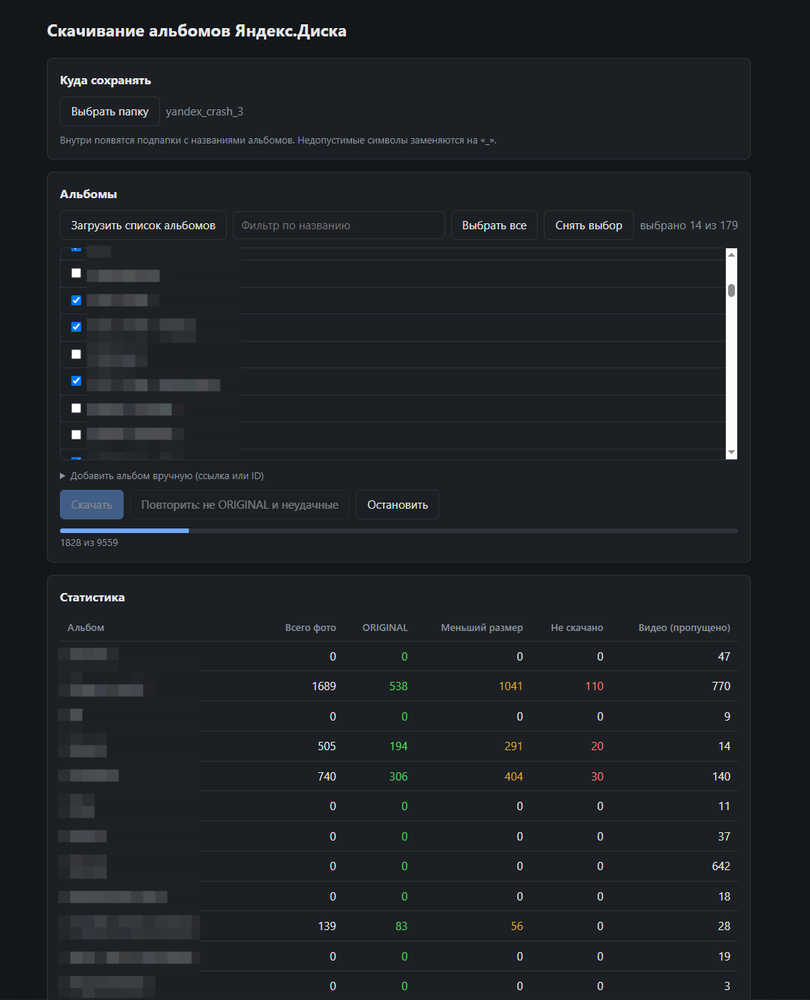
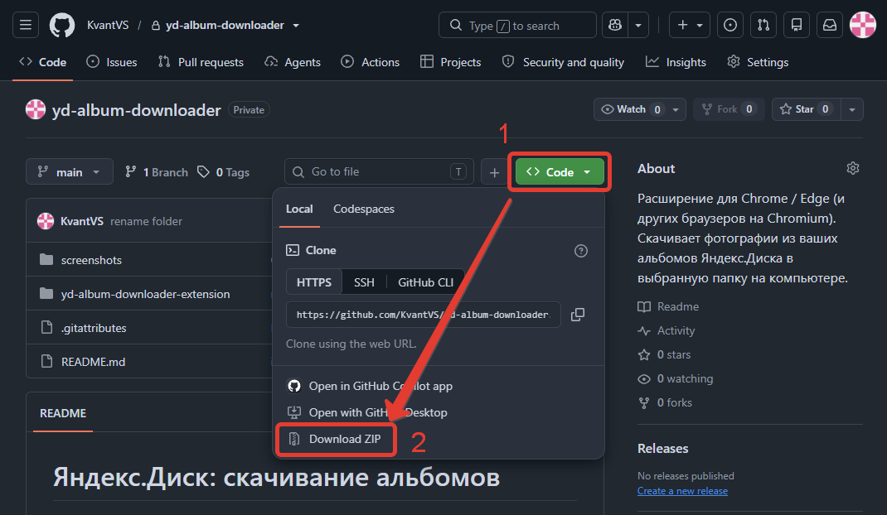

# Яндекс.Диск: скачивание альбомов.

Расширение для Chrome / Edge и других браузеров на Chromium. Скачивает фотографии (без видео) из ваших альбомов Яндекс.Диска
в выбранную папку на компьютере. Включает в себя скачивание фотографий с вашего Безлимитного хранилища, но только тех, которые распределены по альбомам.

**ВИДЕО ИГНОРИРУЮТСЯ**, работает только для фотографий.

## Установка
1. Скачайте весь репозиторий, нажав на зелёную кнопку Code, а затем Download ZIP:

2. Распакуйте куда-нибудь архив. Самое важное - папка внутри, которая называется `yd-album-downloader-extension`;
3. Откройте в браузере `chrome://extensions` (расширения браузера), включите там «Режим разработчика»;
4. Нажмите «Загрузить распакованное расширение», зайдите в папку `yd-album-downloader-extension` и нажмите Выбор папки;
5. Войдите в Яндекс.Диск (disk.yandex.ru) в этом же браузере;
6. Нажмите на иконку расширения (обычно это буква Я на сером фоне) — откроется страница загрузчика.

## Использование
1. Нажмите `Выбрать папку` куда сохранять ваши фотографии, они будут сохраняться по подпапкам с именами альбомов;
2. Выбирайте галочками альбомы, которые хотите скачать;
3. Кнопка `Скачать` - пойдёт скачивать все фотографии из выбранных альбомов;
4. Скачивание идёт медленно. Поэтому можете заниматься другими делами. Скачиваются по возможности оригинальная фотография. Если ему не удаётся, то - превьюшки размером поменьше (самая большая: 1280*720). Ниже есть журнал процесса скачивания, есть кнопка `Экспорт лога (CSV)`, чтобы сохранить для себя журнал на всякий случай. Есть кнопка `Повторить: не ORIGINAL и неудачные` - повторяет попытки скачать фотографии, которые скачаны в меньшем размере, чем оригинал или которые не скачаны вовсе. По очевидным причинам сейчас от неё мало толку, но по мере починки яндекса, потом поможет скачать остальные фотографии.

## Как это работает
- Список альбомов и фотографий запрашивается теми же методами, что использует веб-версия Диска.
- Для каждой фотографии пробуется размер ORIGINAL, затем XXXL, XXL … XXXS — сохраняется первый, что скачался.
- Видео пропускаются.
- Внутри выбранной папки создаются подпапки с названиями альбомов; недопустимые для ОС символы заменяются на «_».
- Журнал по каждому файлу хранится в IndexedDB браузера; доступны статистика, экспорт в CSV и повторное скачивание
  файлов, которые скачались не в ORIGINAL или не скачались вовсе.

## Приватность
- Расширение работает только локально и обращается только к серверам Яндекса (`*.yandex.ru`, `*.yandex.net`, `*.yandex.com`).
  Ничего не отправляется ни автору, ни третьим лицам.
- Токен `sk` и `uid` расширение само получает со страницы Диска, под вашей текущей учётной записью.
- Разрешение `cookies` нужно только для чтения одной cookie — `yandex_login` (логин, под которым вы вошли), чтобы
  убедиться, что взят `uid` именно вашего аккаунта, а не другого пользователя из семейной группы, если она у вас есть.
  Значения cookie не сохраняются и никуда не передаются.
- Разрешение `declarativeNetRequest` нужно, чтобы запросы расширения к Яндексу шли с теми же заголовками `Origin`/`Referer`,
  что и у веб-версии Диска. Правило действует только на запросы самого расширения.

## Ограничения
- Желательно заходить в домен .ru: `disk.yandex.ru` даже если у вас аккаунт .kz, как у меня, при этом всё работает корректно.
- Скачивание в выбранную папку использует File System Access API — только браузеры на Chromium.
